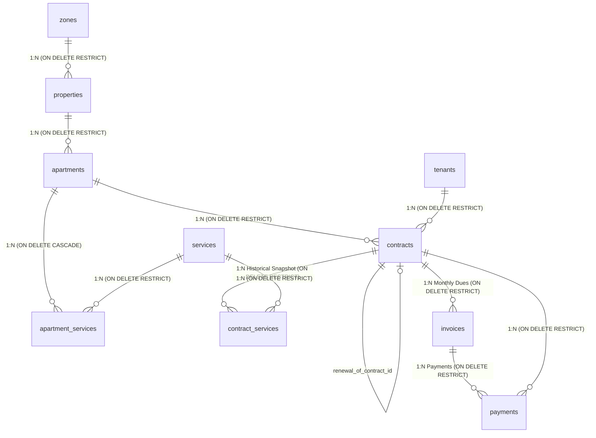

# تقرير تنفيذ المرحلة الثانية: قاعدة البيانات والمنطق المالي والربط الفعلي
## مشروع Ejary Platform — منصة إيجاري لإدارة العقارات والإيجارات (Offline-First)

---

## 1. ملخص المرحلة الثانية

تم استكمال **المرحلة الثانية (Database & Integration)** بالكامل وفق المتطلبات المعتمدة في `Ejary_platform.md` دون تغيير التصميم البصري المعتمد في المرحلة الأولى، مع إزالة شريط المعاينة المؤقت (`Phase1NoticeBanner`) وربط جميع الشاشات الـ 26 والـ `GetxControllers` بطبقات `Use Cases` و`Repositories` وقاعدة بيانات **SQLite** المحلية الفعلية.

---

## 2. مخطط العلاقات وقاعدة البيانات (ERD & Relational Schema)

---

## 3. الجداول والحقول والقيود والفهارس المنفذة (`DatabaseMigrations`)

تم تفعيل `PRAGMA foreign_keys = ON` عند تهيئة قاعدة البيانات في `AppDatabase`، وتخزين جميع المبالغ المالية كأعداد صحيحة (`INTEGER`) لمنع أخطاء الفاصلة العائمة (`floating-point errors`)، وتخزين التواريخ بصيغة `ISO 8601 (YYYY-MM-DD)` وشهر الفوترة بصيغة `YYYY-MM`:

1. **`app_metadata`**:
   - الحقول: `key (TEXT PK)`, `value (TEXT NOT NULL)`, `updated_at (TEXT NOT NULL)`
   - الوظيفة: حفظ إصدار مخطط قاعدة البيانات (`schema_version = 1`) وعَلَم إدراج البيانات التجريبية (`seed_data_loaded`) لمنع تكرارها.
2. **`zones`**:
   - الحقول: `id (INTEGER PK AUTOINCREMENT)`, `name (TEXT NOT NULL UNIQUE)`, `description (TEXT)`, `created_at (TEXT NOT NULL)`
3. **`properties`**:
   - الحقول: `id (PK)`, `name (NOT NULL)`, `description`, `status CHECK IN ('active','inactive','maintenance')`, `type CHECK IN ('residential','commercial','mixed','other')`, `zone_id (FK -> zones.id ON DELETE RESTRICT)`, `longitude (REAL)`, `latitude (REAL)`, `created_at`
   - الفهرس: `idx_properties_zone`
4. **`apartments`**:
   - الحقول: `id (PK)`, `property_id (FK -> properties.id ON DELETE RESTRICT)`, `apartment_number (NOT NULL)`, `floor (INTEGER)`, `rooms_count (CHECK > 0)`, `base_rent (INTEGER CHECK >= 0)`, `status CHECK IN ('vacant','rented','maintenance','unavailable')`, `notes`, `created_at`
   - القيد الفريد: `UNIQUE(property_id, apartment_number)`
   - الفهارس: `idx_apartments_property`, `idx_apartments_status`
5. **`services`**:
   - الحقول: `id (PK)`, `name (UNIQUE NOT NULL)`, `description`, `default_price (INTEGER CHECK >= 0)`, `billing_type CHECK IN ('fixed_monthly','usage_based')`, `is_active (INTEGER CHECK IN (0,1))`, `created_at`
6. **`apartment_services`**:
   - الحقول: `id (PK)`, `apartment_id (FK -> apartments.id ON DELETE CASCADE)`, `service_id (FK -> services.id ON DELETE RESTRICT)`, `custom_price (INTEGER CHECK >= 0)`, `billing_type`, `is_active`, `notes`, `created_at`
   - القيد الفريد: `UNIQUE(apartment_id, service_id)`
   - الفهرس: `idx_apt_services_apt`
7. **`tenants`**:
   - الحقول: `id (PK)`, `full_name (NOT NULL)`, `phone (NOT NULL)`, `national_id (UNIQUE NOT NULL)`, `notes`, `created_at`
8. **`contracts`**:
   - الحقول: `id (PK)`, `contract_number (UNIQUE NOT NULL)`, `apartment_id (FK -> apartments.id ON DELETE RESTRICT)`, `tenant_id (FK -> tenants.id ON DELETE RESTRICT)`, `started_at`, `end_at`, `created_at`, `price (INTEGER CHECK >= 0)`, `total_services (INTEGER CHECK >= 0)`, `conditions_json`, `due_date`, `due_day (CHECK 1..31)`, `rental_at`, `auto_renew (0/1)`, `status CHECK IN ('active','expiring','expired','terminated')`, `notes`, `renewal_of_contract_id (FK -> contracts.id)`, `termination_date`, `termination_reason`
   - الفهارس: `idx_contracts_apt`, `idx_contracts_tenant`, `idx_contracts_status`
9. **`contract_services`** (النسخة التاريخية المستقلة لخدمات العقد `FR-09`):
   - الحقول: `id (PK)`, `contract_id (FK -> contracts.id ON DELETE RESTRICT)`, `service_id (FK -> services.id ON DELETE RESTRICT)`, `service_name (NOT NULL)`, `price (INTEGER CHECK >= 0)`, `billing_type`, `created_at`
   - الفهرس: `idx_contract_services_cnt`
10. **`invoices`**:
    - الحقول: `id (PK)`, `contract_id (FK -> contracts.id ON DELETE RESTRICT)`, `billing_month (YYYY-MM NOT NULL)`, `due_date`, `base_rent (INTEGER)`, `services_total (INTEGER)`, `total_amount (INTEGER)`, `paid_amount (INTEGER)`, `remaining_amount (INTEGER)`, `status CHECK IN ('Pending','Partially Paid','Paid','Overdue','Cancelled')`, `created_at`
    - القيد الفريد: `UNIQUE(contract_id, billing_month)` (يمنع تكرار فاتورة لنفس العقد والشهر على مستوى قاعدة البيانات)
    - الفهارس: `idx_invoices_contract`, `idx_invoices_month`, `idx_invoices_status`
11. **`payments`**:
    - الحقول: `id (PK)`, `contract_id (FK -> contracts.id ON DELETE RESTRICT)`, `invoice_id (FK -> invoices.id ON DELETE RESTRICT)`, `type CHECK IN ('full','partial')`, `pay_at`, `amount (INTEGER CHECK > 0)`, `pay_method CHECK IN ('cash','bank','remittance','other')`, `pay_ref`, `billing_month`, `notes`, `is_cancelled (INTEGER CHECK IN (0,1))`, `created_at`
    - الفهارس: `idx_payments_invoice`, `idx_payments_contract`

---

## 4. المعمارية المنفذة (Models, Repositories, Use Cases)

| Feature | Model | Repository Contract & Implementation | Use Case / Service |
|---|---|---|---|
| `zones` | `ZoneModel` | `ZoneRepository` / `ZoneRepositoryImpl` | `ManageZonesUseCase` |
| `properties` | `PropertyModel` | `PropertyRepository` / `PropertyRepositoryImpl` | `ManagePropertiesUseCase` |
| `apartments` | `ApartmentModel`, `ApartmentServiceModel` | `ApartmentRepository` / `ApartmentRepositoryImpl` | `ManageApartmentsUseCase` |
| `services` | `ServiceModel` | `ServiceRepository` / `ServiceRepositoryImpl` | `ManageServicesUseCase` |
| `tenants` | `TenantModel` | `TenantRepository` / `TenantRepositoryImpl` | `ManageTenantsUseCase` |
| `contracts` | `ContractModel`, `ContractServiceModel` | `ContractRepository` / `ContractRepositoryImpl` | `ManageContractsUseCase` |
| `invoices` | `InvoiceModel` | `InvoiceRepository` / `InvoiceRepositoryImpl` | `ManageInvoicesUseCase` |
| `payments` | `PaymentModel` | `PaymentRepository` / `PaymentRepositoryImpl` | `ManagePaymentsUseCase`, `ReceiptPdfService` |
| `dashboard` | `DashboardSummaryEntity` | `DashboardLocalDataSource` | استعلامات SQLite التجميعية المباشرة |
| `settings` | `BackupMetadataEntity` | `BackupLocalDataSource` | تصدير واستعادة النسخة الاحتياطية مع فحص السلامة |

---

## 5. سياسة البيانات التجريبية والبيانات الفعلية (Seed vs Production Data Policy)

تم تطبيق السياسة المعتمدة بدقة في `AppDatabase` و`DatabaseSeeder`:
1. **في النسخة النهائية (`main.dart` -> `isTestEnvironment: false, autoSeedInTest: false`):** تبدأ قاعدة البيانات **فارغة تماماً** عند أول تشغيل ليبدأ المالك بإدخال بياناته الحقيقية دون أي بيانات وهمية مفروضة.
2. **خيار اختياري آمن لتجربة النظام:** تم توفير خيار في شاشة الإعدادات (`Load Demo Seed Data / بيانات تجريبية`) يقوم باستدعاء `DatabaseSeeder.seedIfEmpty(db)` الذي يتحقق أولاً من خلو قاعدة البيانات وعدم وجود بيانات للمالك قبل إدراج البيانات التجريبية لمرة واحدة فقط داخل `SQLite Transaction`.
3. **في بيئة الاختبار (`isTestEnvironment: true`):** يمكن للاختبارات الآلية اختبار حالة البداية الفارغة واختبار البيانات التجريبية المترابطة بشكل معزول تماماً.

---

## 6. نتائج اختبارات المرحلة الثانية (`flutter analyze` & `flutter test`)

- **`flutter analyze`:** `No issues found!`.
- **`flutter test`:** نجاح جميع اختبارات قاعدة البيانات والمنطق المالي والواجهات (`All tests passed!`).
