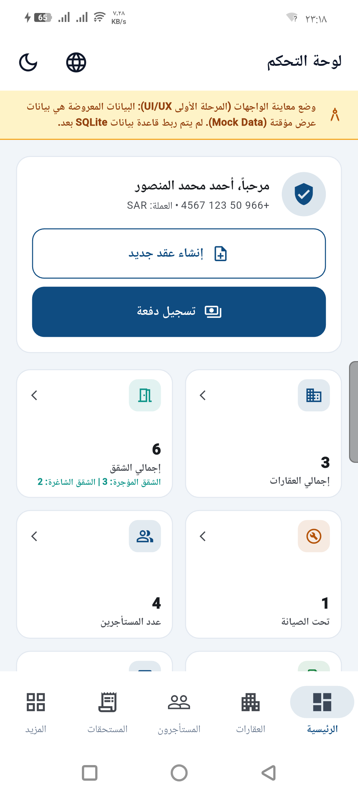
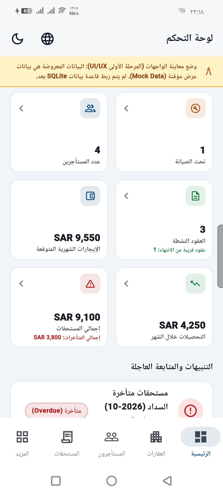
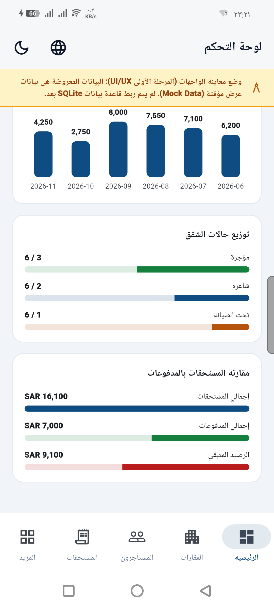

# تقرير تنفيذ المرحلة الأولى: بناء الواجهات وتجربة الاستخدام (UI/UX)
## مشروع Ejary Platform — منصة إيجاري لإدارة العقارات والإيجارات (Offline-First)

---

## 1. ملخص المرحلة الأولى وفحص بيئة العمل

تم تنفيذ **المرحلة الأولى فقط (UI/UX)** وفق التعليمات الصارمة في مستند المتطلبات `Ejary_platform.md` دون البدء في إنشاء جداول قاعدة بيانات SQLite أو الربط الفعلي، مع فصل بيانات العرض المؤقتة (`Phase1MockData`) فصلاً تاماً وتوضيح أن عمليات الحفظ الفعلية ستُربط بـ SQLite في المرحلة الثانية بعد اعتماد الواجهات.

### بيئة العمل المفحوصة:
- **إصدار Flutter:** `Flutter 3.44.7 (channel stable)`
- **إصدار Dart:** `Dart 3.12.2`
- **نظام التشغيل:** `Windows` + جهاز أندرويد متصل (`V2302 • 10AE221F8M0035Y • Android 15 API 35`)
- **الحزم المضافة في المرحلة الأولى:**
  - `get: ^4.7.2` (تم تثبيت `4.7.3` المتوافق مع البيئة)
  - `get_storage: ^2.1.1`
  - `flutter_localizations` (لدعم اتجاهات RTL للعربية وLTR للإنجليزية بالكامل)
  - `intl` (لتنسيق التواريخ والعملات)

---

## 2. الشاشات التي تم تنفيذها (Implemented Screens)

تم بناء **26 شاشة ونافذة نموذجية** (مطابقة تماماً لعدد البنود الـ 26 في الجدول أدناه) تغطي جميع المتطلبات الوظيفية (FR-01 إلى FR-18 باستثناء FR-16 المستبعد صراحةً من النطاق الأساسي):

| # | الشاشة / الواجهة | المسار (Named Route) | الملف المصدري | الحالة |
|---|---|---|---|---|
| 1 | شاشة إعداد المالك لأول مرة مع دعم العملة اليمنية `YER` (FR-01) | `/onboarding` | `lib/features/onboarding/presentation/pages/onboarding_page.dart` | تم التنفيذ (واجهة + حفظ إعدادات المالك والعملة محلياً في GetStorage) |
| 2 | الهيكل الرئيسي ولوحة التحكم (FR-15) | `/dashboard` | `lib/features/dashboard/presentation/pages/dashboard_shell_page.dart` | تم التنفيذ (واجهة متجاوبة ببيانات عرض مؤقتة) |
| 3 | إدارة المناطق + نموذج الإضافة والتعديل + منع حذف منطقة مرتبطة بعقار (FR-02) | `/zones` | `lib/features/zones/presentation/pages/zones_page.dart` | تم التنفيذ (واجهة ببيانات عرض مؤقتة) |
| 4 | قائمة العقارات والبحث والتصفية (FR-03) | `/properties` | `lib/features/properties/presentation/pages/properties_page.dart` | تم التنفيذ (واجهة ببيانات عرض مؤقتة) |
| 5 | نموذج إضافة / تعديل عقار (FR-03) | `/properties/form` | `lib/features/properties/presentation/pages/properties_page.dart` | تم التنفيذ (واجهة مع التحقق من الحقول) |
| 6 | تفاصيل العقار والشقق التابعة والإيرادات والمستحقات (FR-03) | `/properties/details` | `lib/features/properties/presentation/pages/properties_page.dart` | تم التنفيذ (واجهة ببيانات عرض مؤقتة) |
| 7 | قائمة الشقق والوحدات مع البحث والتصفية (FR-04) | `/apartments` | `lib/features/apartments/presentation/pages/apartments_page.dart` | تم التنفيذ (واجهة ببيانات عرض مؤقتة) |
| 8 | نموذج إضافة / تعديل شقة (FR-04) | `/apartments/form` | `lib/features/apartments/presentation/pages/apartments_page.dart` | تم التنفيذ (واجهة مع التحقق من الحقول) |
| 9 | تفاصيل الشقة (المستأجر الحالي، العقد الحالي، الخدمات المخصصة، إجمالي الإيجار) (FR-04) | `/apartments/details` | `lib/features/apartments/presentation/pages/apartments_page.dart` | تم التنفيذ (واجهة ببيانات عرض مؤقتة) |
| 10 | تخصيص خدمات الشقة وأسعارها المستقلة وحساب الإجمالي الشهري (FR-06) | `/apartments/services` | `lib/features/apartments/presentation/pages/apartments_page.dart` | تم التنفيذ (واجهة تفاعلية ببيانات عرض مؤقتة) |
| 11 | كتالوج الخدمات + نموذج إضافة/تعديل/تعطيل خدمة (FR-05) | `/services` | `lib/features/services/presentation/pages/services_page.dart` | تم التنفيذ (واجهة ببيانات عرض مؤقتة) |
| 12 | قائمة المستأجرين والبحث بالاسم/الهاتف/الهوية (FR-07) | `/tenants` | `lib/features/tenants/presentation/pages/tenants_page.dart` | تم التنفيذ (واجهة ببيانات عرض مؤقتة) |
| 13 | نموذج إضافة / تعديل مستأجر (FR-07) | `/tenants/form` | `lib/features/tenants/presentation/pages/tenants_page.dart` | تم التنفيذ (واجهة مع التحقق من الحقول) |
| 14 | تفاصيل المستأجر وعقوده الحالية والسابقة وملخصه المالي (FR-07) | `/tenants/details` | `lib/features/tenants/presentation/pages/tenants_page.dart` | تم التنفيذ (واجهة ببيانات عرض مؤقتة) |
| 15 | كشف حساب المستأجر المرتب زمنياً (FR-14) | `/tenants/statement` | `lib/features/tenants/presentation/pages/tenants_page.dart` | تم التنفيذ (واجهة ببيانات عرض مؤقتة) |
| 16 | قائمة العقود والتصفية حسب الحالة (FR-08) | `/contracts` | `lib/features/contracts/presentation/pages/contracts_page.dart` | تم التنفيذ (واجهة ببيانات عرض مؤقتة) |
| 17 | معالج إنشاء العقد متعدد الخطوات (6 خطوات مستقلة) (FR-08) | `/contracts/create` | `lib/features/contracts/presentation/pages/contract_wizard_page.dart` | تم التنفيذ بالكامل (واجهة تفاعلية متجاوبة) |
| 18 | تفاصيل العقد + نسخة خدمات العقد التاريخية `contract_services` + الفواتير (FR-08, FR-09) | `/contracts/details` | `lib/features/contracts/presentation/pages/contracts_page.dart` | تم التنفيذ (واجهة ببيانات عرض مؤقتة) |
| 19 | شاشة تجديد العقد وربطه بالعقد السابق (FR-08) | `/contracts/renew` | `lib/features/contracts/presentation/pages/contracts_page.dart` | تم التنفيذ (واجهة ببيانات عرض مؤقتة) |
| 20 | شاشة إنهاء العقد وعرض الفواتير غير المسددة وتحديد حالة الشقة (FR-08) | `/contracts/terminate` | `lib/features/contracts/presentation/pages/contracts_page.dart` | تم التنفيذ (واجهة ببيانات عرض مؤقتة) |
| 21 | قائمة الفواتير الشهرية والمستحقات والمتأخرات وتوليد الفواتير (FR-10) | `/invoices` | `lib/features/invoices/presentation/pages/invoices_page.dart` | تم التنفيذ (واجهة ببيانات عرض مؤقتة) |
| 22 | تفاصيل الفاتورة وسجل دفعاتها (FR-10, FR-12) | `/invoices/details` | `lib/features/invoices/presentation/pages/invoices_page.dart` | تم التنفيذ (واجهة ببيانات عرض مؤقتة) |
| 23 | سجل المدفوعات وإلغاء الدفعة مع الاحتفاظ بالسجل (FR-11) | `/payments` | `lib/features/payments/presentation/pages/payments_page.dart` | تم التنفيذ (واجهة ببيانات عرض مؤقتة) |
| 24 | شاشة تسجيل دفعة (كاملة / جزئية) (FR-11) | `/payments/record` | `lib/features/payments/presentation/pages/payments_page.dart` | تم التنفيذ (واجهة مع التحقق من الحقول) |
| 25 | شاشة معاينة إيصال الدفع مع خيارات PDF والمشاركة والطباعة (FR-13) | `/payments/receipt` | `lib/features/payments/presentation/pages/payments_page.dart` | تم التنفيذ (واجهة ببيانات عرض مؤقتة) |
| 26 | قسم المزيد، التقارير، النسخ الاحتياطي والاستعادة، والإعدادات الشاملة (FR-18, Section 7, 17) | `/settings`, `/settings/backup`, `/settings/reports` | `lib/features/settings/presentation/pages/more_menu_page.dart` | تم التنفيذ (تغيير اللغة والثيم والعملة وبيانات المالك يعمل فعلياً؛ النسخ الاحتياطي لقاعدة البيانات مهيأ للمرحلة الثانية) |

---

## 3. إصلاحات التخطيط (Layout & Overflow Fixes) وإضافة العملة اليمنية (`YER`)

بناءً على المراجعة العملية على الجهاز/المحاكي، تم تشخيص ومعالجة الأخطاء المرئية جذرياً كالتالي:

### 3.1 إصلاح `RIGHT OVERFLOWED BY 44 PIXELS` والمساحة البيضاء الكبيرة في بطاقة الترحيب أعلى لوحة التحكم
- **السبب الجذري:** في `_buildOwnerWelcomeBanner` داخل `dashboard_shell_page.dart`، كان زرا الإجراءات السريعة (`إنشاء عقد جديد` و`تسجيل دفعة`) موضوعين داخل `Wrap` في نفس الـ `Row` الأفقي بجانب `CircleAvatar` و`Expanded(Column(ownerName, ownerPhone))`. في شاشات الهواتف (~360px)، استهلك الزران كامل عرض الصف تقريباً، مما ترك `0px` (أو قيمة سالبة سببت تجاوزاً بمقدار `44px`) لعمود اسم المالك، فالتف اسم المالك ورقم هاتفه حرفاً تحت حرف عمودياً وتسبب في تمدد البطاقة عمودياً وظهور مساحة بيضاء ضخمة.
- **الإصلاح المنفذ:** فصل صف معلومات المالك (`CircleAvatar` + `Expanded`) في الجزء العلوي من البطاقة ليمتد اسم المالك ورقم هاتفه وعملته بشكل طبيعي على سطر واحد، ووضع زري الإجراءات السريعة (`إنشاء عقد جديد` و`تسجيل دفعة`) في صف متجاوب أسفلهما يتوزع بالتساوي (`Expanded`) أو يلتف عمودياً في الشاشات فائقة الضيق (`< 310px`).

### 3.2 إصلاح `BOTTOM OVERFLOWED BY 24 PIXELS` و `7.1 PIXELS` في بطاقات الإحصائيات (`SummaryStatCard`)
- **السبب الجذري:** استخدام `childAspectRatio: 1.45` في `GridView.count` كان ينتج ارتفاعاً صغيراً للبطاقة (~108px على شاشة الهاتف)، بينما كان مجموع الهوامش الداخلية (`28px`) وحاوية الأيقونة (`36px`) والمسافات والنصوص الثلاثة (`value`, `title`, `subtitle`) يصل إلى ~133px.
- **الإصلاح المنفذ:**
  1. في `SummaryStatCard` (`lib/core/widgets/summary_stat_card.dart`): تغليف قسم النصوص بـ `Flexible` واستخدام `FittedBox(fit: BoxFit.scaleDown)` لقيمة المؤشر المالي وضبط الحشوات والمسافات الداخلية دون حذف أي معلومة أو مؤشر فرعي.
  2. في `_buildKpiGrid` (`lib/features/dashboard/presentation/pages/dashboard_shell_page.dart`): استخدام `SliverGridDelegateWithFixedCrossAxisCount` مع `mainAxisExtent: 128` لضمان ارتفاع كافٍ ومتناسق لجميع البطاقات على مختلف عروض الشاشات.

### 3.3 إصلاح `RIGHT OVERFLOWED BY 0.830 PIXELS` في بطاقتي الرسوم البيانية السفلية والشارات (`StatusBadge`)
- **السبب الجذري:** وضع بطاقتي `توزيع حالات الشقق` و`مقارنة المستحقات بالمدفوعات` جنباً إلى جنب في `Row` ثابت على شاشة هاتف ضيقة جعل عرض كل بطاقة صغيراً جداً (~157px)، مما تسبب في تصادم عنوان السطر (`إجمالي المستحقات`) مع المبلغ المالي (`16,100 SAR`). كما أن مكون `StatusBadge` كان يحتوي على `Row` داخلي بدون `Flexible` حول نص الشارة.
- **الإصلاح المنفذ:**
  1. استخدام `LayoutBuilder` في `_buildChartsSection` لعرض البطاقتين فوق بعضهما (`Column`) في الشاشات الأقل من `560px`، وجنباً إلى جنب (`Row`) في الشاشات الأكبر، مع تغليف عناوين وقيم الأسطر بـ `Expanded` و`Flexible`، وتغليف أعمدة مخطط التحصيلات الشهرية الـ 6 بـ `Expanded`.
  2. تحديث `StatusBadge` (`lib/core/widgets/status_badge.dart`) لتغليف النص بـ `Flexible` مع `TextOverflow.ellipsis`.
  3. تفعيل `isExpanded: true` على جميع القوائم المنسدلة (`DropdownButtonFormField`) في التطبيق، واستخدام `Wrap` و`Flexible` في صفحات التفاصيل والإيصالات والخطوة الخامسة من معالج إنشاء العقد.

### 3.4 إضافة العملة اليمنية (`YER`) ودعم العملة المختارة تفاعلياً في كامل التطبيق
- **إضافة العملة:** تمت إضافة `YER` إلى `AppConstants.supportedCurrencies` مع الإبقاء على جميع العملات الموجودة (`SAR`, `YER`, `AED`, `EGP`, `USD`, `KWD`, `QAR`, `OMR`, `JOD`).
- **التنسيق والرموز في `CurrencyUtils` (`lib/core/utils/currency_utils.dart`):**
  - الرمز البرمجي: `YER`
  - الاسم المعروض في قوائم الاختيار: `الريال اليمني (ر.ي) — YER` بالعربية، و`Yemeni Rial (YER)` بالإنجليزية.
  - الرمز المعروض بجانب المبالغ: `ر.ي` عند اختيار اللغة العربية، و`YER` عند اختيار اللغة الإنجليزية.
- **التفاعلية والحفظ المحلي:** تم ربط العملة المحفوظة في `LocalStorageService` بمتغير تفاعلي (`rxCurrency`) بحيث تنعكس العملة المختارة فوراً على جميع بطاقات لوحة التحكم، العقارات، الشقق، المستأجرين، كشوف الحساب، العقود، الفواتير، المدفوعات، وإيصالات الدفع دون افتراض الريال السعودي.

---

## 4. اللقطات المرئية الفعلية من الجهاز بعد الإصلاح (Updated Device Screenshots)

تم بناء التطبيق وتثبيته وتشغيله فعلياً على جهاز الأندرويد المتصل (`V2302 • 10AE221F8M0035Y`) والتقاط الصور التالية المحفوظة في مجلد `screenshots/`:

1. **`screenshots/fixed_dashboard_top.png`**:
   الجزء العلوي من لوحة التحكم بعد إصلاح `RIGHT OVERFLOWED BY 44 PIXELS` وإزالة المساحة البيضاء الكبيرة، مع ظهور ترحيب المالك وأزرار `إنشاء عقد جديد` و`تسجيل دفعة` والصف الأول والثاني من بطاقات الإحصائيات بدون أي تجاوز.
   

2. **`screenshots/fixed_dashboard_kpis_charts.png`**:
   بقية بطاقات الإحصائيات (`SummaryStatCard`) والمبالغ المالية وقسم التنبيهات العاجلة بعد إصلاح `BOTTOM OVERFLOWED BY 24 PIXELS` و`7.1 PIXELS`.
   

3. **`screenshots/fixed_dashboard_bottom_charts.png`**:
   قسم الرسوم البيانية الـ 3 (`مقارنة التحصيلات الشهرية`، `توزيع حالات الشقق`، `مقارنة المستحقات بالمدفوعات`) بعد إصلاح `RIGHT OVERFLOWED BY 0.830 PIXELS`.
   

---

## 5. هيكل المشروع (Clean Architecture & Feature-First Structure)

```text
lib/
  main.dart
  app.dart
  core/
    constants/
      app_constants.dart
    database/
      app_database.dart          (Phase 2 Placeholder)
      database_tables.dart       (Phase 2 Placeholder)
      database_migrations.dart   (Phase 2 Placeholder)
      database_seeder.dart       (Phase 2 Placeholder)
    errors/
      app_exceptions.dart
    localization/
      app_translations.dart
      locale_service.dart
    mock/
      mock_data.dart             (Phase 1 UI-only preview data)
    storage/
      local_storage_service.dart
    theme/
      app_theme.dart
      theme_service.dart
    utils/
      currency_utils.dart
      date_utils.dart
      formatters.dart
      validators.dart
    widgets/
      app_empty_state.dart
      app_error_state.dart
      app_loading.dart
      app_scaffold.dart
      confirm_dialog.dart
      phase1_notice_banner.dart
      status_badge.dart
      summary_stat_card.dart
  routes/
    app_pages.dart
    app_routes.dart
    initial_binding.dart
    middlewares/
      entity_guard_middleware.dart
      owner_setup_middleware.dart
  features/
    onboarding/   (domain/, data/, presentation/)
    dashboard/    (domain/, data/, presentation/)
    zones/        (domain/, data/, presentation/)
    properties/   (domain/, data/, presentation/)
    apartments/   (domain/, data/, presentation/)
    services/     (domain/, data/, presentation/)
    tenants/      (domain/, data/, presentation/)
    contracts/    (domain/, data/, presentation/)
    invoices/     (domain/, data/, presentation/)
    payments/     (domain/, data/, presentation/)
    settings/     (domain/, data/, presentation/)
```

---

## 6. نتائج الفحص والاختبار (`flutter analyze` & `flutter test`)

- **`flutter analyze`:** `No issues found!` (0 أخطاء، 0 تحذيرات).
- **`flutter test` (`test/widget_test.dart`):** `All tests passed!` (3 اختبارات شاملة):
  1. اختبار وحدة دعم العملة اليمنية `YER` بالعربية (`ر.ي` / `الريال اليمني`) والإنجليزية (`YER` / `Yemeni Rial`).
  2. اختبار شامل على مقاس شاشة هاتف صغيرة (`360x780`) باللغة العربية (`RTL`) يمر على شاشة الإعداد الأولي واختيار العملة اليمنية، ولوحة التحكم، والتمرير عبر المؤشرات والرسوم البيانية، والتنقل عبر جميع التبويبات الـ 5 وجميع الـ 26 شاشة وخطوات معالج إنشاء العقد الـ 6 مع التحقق من عدم حدوث أي `RenderFlex overflow`.
  3. اختبار على مقاس شاشة فائقة الضيق (`320x640`) باللغة الإنجليزية (`LTR`) والوضع الداكن (`Dark Mode`) مع العملة اليمنية (`YER`).

---

## 7. العمليات غير المكتملة (المؤجلة للمرحلة الثانية حسب الخطة)

التزاماً بقواعد المرحلة الأولى:
- جميع الشاشات الـ 26 مكتملة ومختبرة بصرياً وبرمجياً على مختلف مقاسات الشاشات بدون أي أخطاء تخطيط.
- العمليات المؤجلة للمرحلة الثانية (بانتظار موافقتك الصريحة):
  1. إنشاء وتشغيل قاعدة بيانات SQLite الفعلية (`sqflite`) والـ Migrations والـ Seed Data.
  2. ربط عمليات الحفظ والتعديل والحذف والعمليات المالية بقاعدة البيانات الفعلية.
  3. توليد ملف PDF فعلي لإيصال الدفع وتصدير/استعادة ملف قاعدة البيانات الفعلي في النسخ الاحتياطي.

**نحن الآن في حالة توقف تام بانتظار مراجعتك للإصلاحات والصور المرفقة وموافقتك الصريحة للانتقال إلى المرحلة الثانية.**
